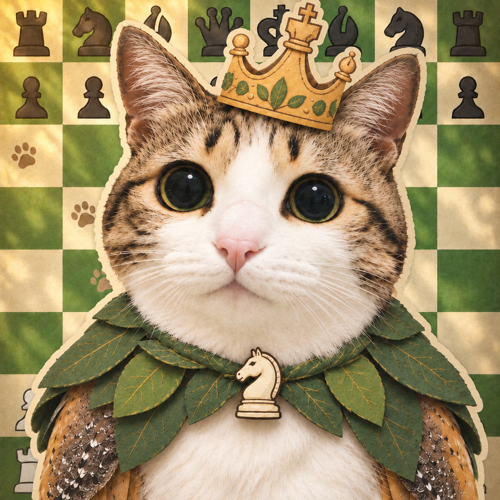

<div align="center">
  
  <h1>MeowlChess</h1>
  <p><strong>Free chess reviews. Local engines. Your own games.</strong></p>
  <p>Review completed games from Chess.com, Lichess, or a PGN file in Brave, Chrome, and Edge.</p>
  <p><sub>Meowl's cat likeness comes from <a href="https://weibo.com/melonpi">Melonpi Cat (瓜皮)</a>. <a href="THIRD_PARTY_NOTICES.md#meowl--melonpi-cat">Artwork credits</a></sub></p>
  <p>
    <a href="https://github.com/ThuyTran735/MeowlChess/releases/latest/download/meowlchess.zip"><strong>Download ZIP</strong></a> ·
    <a href="#install">Install</a> ·
    <a href="#your-first-review">Get started</a> ·
    <a href="PRIVACY.md">Privacy</a> ·
    <a href="https://github.com/ThuyTran735/MeowlChess/issues">Report an issue</a>
  </p>
</div>

**Version 1.7.1** · [Release notes](https://github.com/ThuyTran735/MeowlChess/releases/tag/v1.7.1) · [Release history](https://github.com/ThuyTran735/MeowlChess/releases)

> New in 1.7.1: a new Meowl icon, Reviewed badges that open saved analysis directly, and full-player-name tooltips.

MeowlChess runs Stockfish or Lozza on your device. No subscription, analysis-service account, or chess-site login is required. Once a game is loaded, its analysis works offline.

| What you can do | How it works |
| --- | --- |
| Review a finished game | See both players' study scores, move ratings, opening, and evaluation graph. |
| Get a summary on the game page | Opt in to automatic reviews on Chess.com or Lichess. |
| Explore better moves | Follow engine arrows, play legal variations, or search a position more deeply. |
| Practice your mistakes | Try a move again with hints hidden, then check your answer. |
| Keep a study library | Save completed reviews and bookmark positions locally. |
| Choose your engine and pace | Use Stockfish 18 lite or Lozza 9 with five review speeds. |

MeowlChess is independent of Chess.com and Lichess. Use it **only after a game is finished**, including Daily and correspondence games. Its scores and move labels are its own estimates.

## Install

1. Download [**meowlchess.zip**](https://github.com/ThuyTran735/MeowlChess/releases/latest/download/meowlchess.zip) and extract it to a folder you will keep. See the [latest release](https://github.com/ThuyTran735/MeowlChess/releases/latest) for release notes.
2. Open your browser's extensions page:

   | Browser | Address |
   | --- | --- |
   | Brave | `brave://extensions` |
   | Chrome | `chrome://extensions` |
   | Edge | `edge://extensions` |

3. Enable **Developer mode**, choose **Load unpacked**, and select the extracted **`extension/`** folder. It contains `manifest.json`.
4. Pin MeowlChess and click its toolbar icon to open the review page.

**Updating:** replace the files in the installed folder, click **Reload** on the extension card, refresh open Chess.com or Lichess pages, and reopen the review tab. The installed folder must be the one you updated.

MeowlChess is distributed as an unpacked extension. It is not listed in the Chrome Web Store or Edge Add-ons store.

## Your first review

1. Open **Games** and choose a website, import a PGN, or try the four-move **Sample**.
2. Choose a completed game. Adjust the engine and speed in **Settings** if you want, then select **Review game**.
3. The finished review opens at **move 0** on **Summary**. Switch to **Moves** to explore the game.

Move notation uses small filled piece symbols for White and outlined symbols for Black, including promotions. Pawn moves and castling keep their usual notation. Hover over shortened player names in the board header, score cards, game lists, or saved reviews to see the full names.

The game picker remembers your entry separately for Chess.com and Lichess, including when you open Settings from the on-site panel. Edits are remembered when you leave the field or switch websites, and submitting an entry saves it even if the lookup fails. Clear the field to forget that entry.

The game picker closes after selection. Move through the review with the move list, arrow keys, evaluation graph, key moments, or **Play**. Select a move-rating count on **Summary** to jump to that player’s matching moves, then use the matching-move arrows or **Clear** to return to normal navigation. Hover or focus the evaluation graph to preview a move’s evaluation before selecting it. **Engine lines** stays collapsed until you open it.

On a normal launch, an optional **Support MeowlChess** popup appears before the tutorial. **Star on GitHub** opens the repository in a new tab; you can star it there or choose **Skip** (or press Escape) to continue. Its **Never show again** checkbox is separate from the tutorial preference. Opening a saved review from the on-site panel or going directly to its settings bypasses both prompts.

The three-step tutorial points out the main controls with spotlights and arrows. Use **Next**, **Back**, or **Skip**; Escape also skips it. Check **Never show again** to stop automatic tutorials in this browser profile. The footer's **Tutorial** link reopens it, and unchecking that option restores automatic display. The tour follows smaller screens, restores your scroll position, respects reduced motion, and never starts a review or changes your selected game.

## Supported games

| Source | Ways to load a game |
| --- | --- |
| **Chess.com** | Enter a username for recent public games. On-site reviews can find an exact older game from its game page. |
| **Lichess** | Enter a username or completed-game URL; on-site reviews are also available. |
| **Chess.com bots** | Use the finished game's PGN export through the on-site panel, or import it manually. |
| **ChessTempo, ICC / Chessclub.com, Tornelo** | Import a PGN export. Export guidance is included in the import window; automatic account retrieval is not available. |
| **Other sites** | Import a completed standard-chess game from `.pgn` or `.txt`, or paste its PGN. |
| **Saved reviews / Sample** | Reopen local analysis or try the demo without a network request. |

Recent-game lists contain up to **20 completed games**. On a game page, exact-game lookup is separate from that limit: Chess.com searches the configured player's monthly archives, including older months, and Lichess uses the game's public export. The configured username must be one of the players. Public archives can take time to update after a game ends.

<details>
<summary><strong>PGN imports and limits</strong></summary>

Choose or drop files, drop PGN text, or paste it into **Import PGN**. A file may contain several games; select one from the resulting list before reviewing it. Importing alone does not start analysis or save every game.

Only legal, completed **standard chess** is supported. Variants and unfinished games are excluded. A PGN needs a final `1-0`, `0-1`, or `1/2-1/2` result. Custom standard-chess starting positions and pawn promotions are supported.

An import can contain **100 games** and **5 MiB** of text in total, with **250 KB** and **1,000 plies** per game. Invalid or unfinished entries are listed as skipped while valid games remain available. An imported result is supplied by the PGN; MeowlChess does not independently confirm it with the original website.

</details>

## Reviews on the game page

Open **Settings → On-site reviews**, enter your username, enable the site, and accept its one-time browser permission request. Chess.com and Lichess are separate settings and are **off by default**. Turn a site off before changing its username.

The panel shows each step clearly:

**Finding game → Analyzing → Saving → Summary**

A current saved review goes straight to Summary without another engine run or saving stage. New reviews use your saved engine settings, or **Fast / one line** until you save preferences. **Open full review** opens the saved game at move 0 on Summary.

| Panel control | Action |
| --- | --- |
| Drag the background, summary text, or score cards | Move the panel; buttons, inputs, and scrolling keep their normal behavior. |
| Drag any edge or corner | Resize while keeping the opposite edge in place. |
| Collapse | Keep the header and preserve the expanded size. |
| Close, then select the **MeowlChess** button | Reopen from the bottom-right of the page. A saved summary returns; unfinished analysis starts again. |
| Double-click a resize edge or corner | Restore automatic sizing. |
| Focus the name or bottom-right resize corner | Use arrow keys to move or resize; Shift takes larger steps, and Home resets that control. |

Position and size are remembered separately for each site and kept within the window. Closing the panel, switching tabs, a full page load, leaving the site, or disabling it stops active analysis; partial reviews are not saved. Use the panel's **Settings** shortcut to turn it off and remove its panel and reopen button. You can also remove site access in the browser's extension settings.

**Browsing between pages:** Your current completed-game review keeps its open, collapsed, or closed state as you browse other pages on the same site, including profiles, home, play, and computer pages. Browsing without a full page load also keeps any active analysis of that completed game running. Opening a different specific game clears the old review immediately and looks up that game's completed record; unavailable or unfinished games stay waiting. A new finished round replaces the prior review, and starting a bot rematch clears it. Full page loads briefly recreate the panel; an already-saved review reopens without another engine run.

<details>
<summary><strong>Chess.com bot games</strong></summary>

Bot games are private and do not appear in the public player archive. After a finished-game notice appears, MeowlChess can open Chess.com's normal PGN export and read the completed game. It closes only the export dialog it opened. A small collapsed header is available on the computer page before the game ends.

If the site's controls or language differ, select **Get finished game**, open **Share → PGN** yourself, or choose **Use a PGN file or paste**. Guest games work too. Full PGN exports preserve promotions and custom starting positions.

Bot reviews are saved as PGN imports. Their result comes from the export and cannot be independently confirmed through the public archive. An unfinished bot game never falls back to an older human game. MeowlChess does not read live boards or private bot-game APIs.

</details>

<details>
<summary><strong>Retrieval, timing, and page access</strong></summary>

On Chess.com's multiplayer play screen, MeowlChess watches for a finished-game notice and a new archive entry. On other supported pages, it can show the latest completed game. A visible result notice only opens the waiting panel: a matching completed archive game is still required before analysis starts. The panel contains no board, engine lines, or move suggestions.

Public archive delays mean a review may not start at the last move. When Chess.com shows a finished-game notice, MeowlChess refreshes that lookup immediately and retries every **15 seconds for up to two minutes** while waiting for the completed game. Normal checks use a **60-second interval on Chess.com** and **30 seconds on Lichess**; connection errors keep the normal retry delay. Cached games and temporary review handles use browser session storage, capped at **700 KB** and cleared when the browser restarts. This lets an open summary survive an extension background restart.

The page helper reads the URL, visible game-end notices, and completed bot-game PGN exports. It does not read live board positions or make moves. Public API requests omit login cookies and private Lichess player keys. Disabling a site removes its panel and prevents future helper injection.

</details>

## Engines and review settings

| Engine | Best suited to | Lines |
| --- | --- | --- |
| **Stockfish 18 lite** | Stronger analysis and comparison of alternatives | Up to 3 |
| **Lozza 9** | A smaller JavaScript engine without WebAssembly startup | Best move only |

Both engines are bundled. Switching engines downloads nothing. Lozza is a weaker alternative, not a faster Stockfish; startup and search times depend on your computer. More lines share the available search time and can reduce depth.

**Recheck key mistakes** is on by default. It makes a quick first pass, then spends more time on the most important estimated losses or mate changes. Short searches and selective rechecks can still miss tactics.

<details>
<summary><strong>Speeds and selective rechecks</strong></summary>

| Speed | Per position, rechecks off | First pass, rechecks on |
| --- | --- | --- |
| Fast | 0.05 seconds | 0.05 seconds |
| Quick | 0.15 seconds | 0.15 seconds |
| Standard | 0.5 seconds | 0.15 seconds |
| Deep | 1.5 seconds | 0.15 seconds |
| Thorough | 3 seconds | 0.15 seconds |

With rechecks enabled, the first pass is capped at 0.15 seconds per nonterminal position. Rechecks search both sides of each selected move before assigning its final label, using the chosen time with a minimum of 0.5 seconds and maximum of 3 seconds per position. At most eight moves are revisited, fewer in short games; shared positions are searched once. Progress separates the two passes, and either can be canceled.

Fast automatically selects one line. For 100 nonterminal positions, its first pass uses about five seconds of engine time, plus startup and processing. Rechecks add time. Turn rechecks off to spend the full chosen time on every nonterminal position.

</details>

## Study the game

- **Try again:** replay the position before a reviewed move with engine lines, arrows, ratings, and evaluation hidden. The engine checks your attempt; a sound alternative can pass even if it differs from its first choice. Retry, reveal a continuation, or move to the next mistake. Inconclusive searches are marked uncertain.
- **Explore a variation:** select an engine line, click a piece and destination, or drag a piece. Only legal moves are accepted. Promotions offer queen, rook, bishop, or knight for either color, including captures; Cancel or Escape leaves the position unchanged. **Return to game** restores the original review position without changing the game's moves.
- **Show why:** follow a legal continuation with concrete evidence such as checkmate, a verified fork, or lasting material loss. If no simple consequence can be verified, MeowlChess shows the line without inventing an explanation. These are limited engine observations, not a human coach's assessment.
- **Search further:** **Quick look** spends 0.15 seconds on the displayed position; **Analyze deeper** spends at least 1.5 seconds. Both update that position's evaluation and lines. **Review again** recalculates the full game's labels and scores.

The Moves tab shows the best engine arrow by default; Summary leaves the board clear. Hover over or keyboard-focus another line to preview it, or enable **All engine moves**: green is first, blue second, orange third. Knight arrows turn at a right angle. Arrows always describe the displayed position and side to move; terminal positions have no continuation.

**Face my side** uses your entered or remembered username to put your pieces at the bottom. You can disable it or flip the board manually. Retry mode faces the player whose move is being retried. Display choices and playback speed are saved locally, and motion respects reduced-motion preferences.

## Saved reviews and practice

Successful full reviews save automatically on your device. Recent games and imported PGNs with matching saved analysis show a **Reviewed** badge; select the game to open its saved review directly at move 0 on Summary, without another engine run. **Reviewed · older** identifies saved analysis from an earlier analysis version. The game picker refreshes these badges when opened or brought back into focus. If a saved copy has been removed or cannot be opened, the original game remains available to review.

Search saved games by player or recognized opening, bookmark a position, or open **Practice** to revisit mistakes and bookmarks. Saved games open at move 0 on Summary; bookmarks and practice items open at their position. A saved mistake starts a fresh attempt with hints hidden.

Re-reviewing a game replaces its analysis and keeps its bookmarks. Older analysis is marked so you can choose to refresh it. Temporary variations, practice attempts, and extra position searches are not added to the saved full review.

<details>
<summary><strong>Storage, limits, and deletion</strong></summary>

The local IndexedDB library stores PGNs, player/source information, evaluations and lines, move ratings, scores, opening information, and engine settings. It persists after the tab closes and holds up to **100 reviews**, **40 MiB** in total, and **4 MiB** per review.

MeowlChess does not automatically remove old or bookmarked games to make room. If a limit or browser storage error prevents saving, the current review stays open and an error explains the problem.

Use a saved game's **×** button to delete its stored PGN, analysis, and bookmarks. An already open copy remains in memory; reviewing it again saves it again. Uninstalling removes local extension data. Libraries are separate for each browser profile and do not sync between browsers or devices.

</details>

## Understanding the scores

Evaluations, move labels, and study scores are **MeowlChess estimates**. They do not reproduce Chess.com's proprietary accuracy or classification algorithms. A different engine or longer search can change the result. The graph and displayed evaluations use White's perspective; move counts are separated by player.

The full review and on-site summary also show **Game rating** for each player and **Opening / Middlegame / Endgame** icons. The rating describes this game only, with an approximate value rounded to 50 points. Phase icons summarize each player's moves in that part of the game. Saved reviews gain these summaries without another engine run.

<details>
<summary><strong>Game-rating estimates and phase icons</strong></summary>

Game rating is a rough, **uncalibrated MeowlChess study heuristic**, not an account rating, official Elo, or Chess.com's formula. The concept is similar to [single-game performance in Chess.com's Game Review](https://support.chess.com/en/articles/10773754-how-is-game-rating-calculated-in-game-review), but the numbers need not match. Engine choice and search time can affect the result.

Each player needs at least **8 eligible decisions**. Known Book moves, forced moves with fewer than two legal choices, positions already showing mate, and positions with an estimated expected score outside 10–90% are excluded. A move that loses a competitive position or allows mate still counts. An unavailable estimate displays **—**. Custom starting positions are supported when enough decisions are present; the estimate then covers only the supplied play.

For eligible moves, let `m` be mean expected-score loss (0 to 1). The estimate is `2800 × exp(-20 × m)`, clamped to 300–2800 and rounded to the nearest 50. These constants are project design choices, not a fitted prediction of human Elo. Account ratings and website names are not inputs. Existing study scores and individual move labels are unchanged.

Phases use the position **before** each move:

- **Opening:** the first 20 plies (10 moves per side) from the standard starting position, unless the endgame threshold is reached sooner. Custom starting positions are not assigned an opening phase.
- **Endgame:** total remaining non-pawn material reaches 6 phase units or fewer, counting each knight/bishop as 1, rook as 2, and queen as 4 across both players. The starting position has 24 units. Once reached, the endgame continues even after promotion.
- **Middlegame:** the moves between those phases. Games ending early may have no middlegame or endgame; missing phases show **—**.

Phase grades use mean non-Book expected-score loss with the same Excellent / Good / Inaccuracy / Mistake / Blunder thresholds as individual moves. **Best** requires all scored moves to be engine-preferred and less than 1% mean loss. **Brilliant** or **Great** requires an actual move of that classification, less than 1% mean loss, and no move with 4% or greater loss or an error label. A phase containing only Book moves shows the Book icon. Hover an icon for its player, grade, and move count.

</details>

<details>
<summary><strong>Move labels and score calculation</strong></summary>

| Label | Meaning |
| --- | --- |
| Brilliant | The preferred piece sacrifice, with compensation and lasting material investment in the engine continuation. |
| Great | The preferred response preserving a substantial opportunity after an opponent's error. |
| Best | The engine's preferred move. |
| Excellent | Almost no estimated loss. |
| Good | Little estimated loss. |
| Book | A recorded opening move without a detected error at the chosen search time. |
| Inaccuracy | A small reduction in estimated chances. |
| Mistake | A significant reduction in estimated chances. |
| Blunder | A large reduction in estimated chances. |

Brilliant and Great require depth 12 or greater in relevant positions. Brilliant also requires at least four legal continuation plies, an accepted non-pawn sacrifice with two pawn-equivalents of lasting investment, near-equal or better prospects, and no meaningful loss. Ordinary exchanges and already decisive wins are excluded.

Great requires an opportunity of at least 12 expected-score percentage points, at most one point lost, a nonlosing position, and a legal alternative. Automatic same-square recaptures are excluded. These conservative rules can miss good moves. Miss artwork is included, but there is no separate missed-win classification.

Study scores average `100 × exp(-5 × expected-score loss)` over a player's **non-Book moves**, with engine-preferred moves scoring 100. Book moves count in the move totals but not this average. A player with no scored moves shows **—**.

</details>

<details>
<summary><strong>Opening recognition</strong></summary>

The local reference contains **3,865 lines** from the pinned [Lichess opening-name dataset](https://github.com/lichess-org/chess-openings/tree/712a58be746c143f4ab935b68acc50f4bac813eb), released under CC0. It matches the actual move sequence from the standard starting position, reporting the deepest named opening and first departure from a recorded line. Custom starting positions are not matched. Unrecognized continuations or different move orders are not necessarily mistakes.

The reference includes traps and unsound lines. **Book** applies only when a recorded move is otherwise rated Best, Excellent, or Good. Tactical errors, Brilliant/Great classifications, and checkmate retain their labels. An opening name does not establish that every move is sound.

</details>

## Privacy and fair play

Analysis stays on your device. MeowlChess has no analytics, advertising, remote analysis server, or developer-operated service. Saved PGNs, reviews, and bookmarks are not uploaded by MeowlChess.

Public game retrieval contacts Chess.com or Lichess. Optional page access is requested only when you enable on-site reviews. Preferences use `chrome.storage.local`; the study library uses local IndexedDB. Browser host permissions apply to an origin even when a manifest entry contains a path. See the [privacy notice](PRIVACY.md) for permissions, retention, and deletion details.

Use only completed games and follow [Chess.com's Fair Play rules](https://www.chess.com/legal/fair-play) and [Lichess fair play](https://lichess.org/page/fair-play). API references: [Chess.com Published-Data API](https://www.chess.com/news/view/published-data-api) and [Lichess API documentation](https://lichess.org/api) (Games → Export games of a user / Export one game).

## Development

```sh
npm ci --ignore-scripts
npm run build
npm test
npm run package
```

The build refreshes pinned chess.js and Stockfish assets. Lozza, artwork, and generated opening data are checked in. Regenerate openings from the bundled pinned TSV sources with `node scripts/build-openings.mjs`.

Packaging writes **`dist/meowlchess.zip`** with the ready-to-load extension, project source, tests, notices, opening sources, and Stockfish's corresponding source and evaluation network. Dependencies, generated test results, and Git data are excluded.

<details>
<summary><strong>Browser checks</strong></summary>

Browser checks use Playwright and disposable profiles. Set `CHROMIUM_PATH` to a compatible Brave/Chromium executable, or install Chromium with `npx playwright-core install chromium`.

```sh
npm run test:browser
npm run test:extension
npm run test:features
npm run test:ui
npm run test:performance
npm run test:reviewed
npm run test:imports
npm run test:tutorial
npm run test:notation
npm run test:usernames
npm run test:site-review
npm run test:site-bot
npm run test:site-panel
npm run test:site-panel-extension
```

The site checks use controlled Chess.com/Lichess pages, local API fixtures, and real engines. They cover automatic review, bot exports and fallback, panel movement and resizing, scrolling, controls, and icons. Other checks cover study/library flows, multi-game imports and promotions, and tutorial behavior. These fixtures do not establish compatibility with every live site layout. Chrome compatibility has not been checked directly. Tests do not change your usual browser installation.

`BROWSER_OFFLINE_ASSETS=1` serves local assets in page tests. `LIVE_API_USERNAME` enables an optional real Chess.com lookup. `LIVE_LICHESS_USERNAME` checks a live Lichess archive and game URL; use `HEADED_EXT_TEST=1` for a normal minimized browser because Lichess rejects headless browser user-agents.

</details>

## Help and contributions

Found a problem or have an idea? [Open an issue](https://github.com/ThuyTran735/MeowlChess/issues) with your browser, extension version, and the steps to reproduce it. For review problems, include the engine/speed settings and a completed-game link or PGN when available.

[Browse the source](https://github.com/ThuyTran735/MeowlChess) · [View releases](https://github.com/ThuyTran735/MeowlChess/releases) · [Privacy notice](PRIVACY.md) · [Third-party notices](THIRD_PARTY_NOTICES.md)

## License and artwork

MeowlChess code is [GPL-3.0-or-later](LICENSE). Stockfish is GPL-licensed, chess.js is BSD-2-Clause, Lozza has its own permissive license, and the Lichess opening dataset is CC0. Keep the included notices and engine source materials with redistributions.

The Chess.com Neo pieces and move-icon outlines are third-party artwork, excluded from MeowlChess's code license. Their inclusion does not assert a license grant or affiliation with Chess.com. The project icon features Meowl, whose cat likeness comes from **Melonpi Cat (瓜皮 / Guapi)**. Cat/photo credit: [瓜皮的id酱 (@melonpi on Weibo)](https://weibo.com/melonpi). See [THIRD_PARTY_NOTICES.md](THIRD_PARTY_NOTICES.md) for sources and license details.
