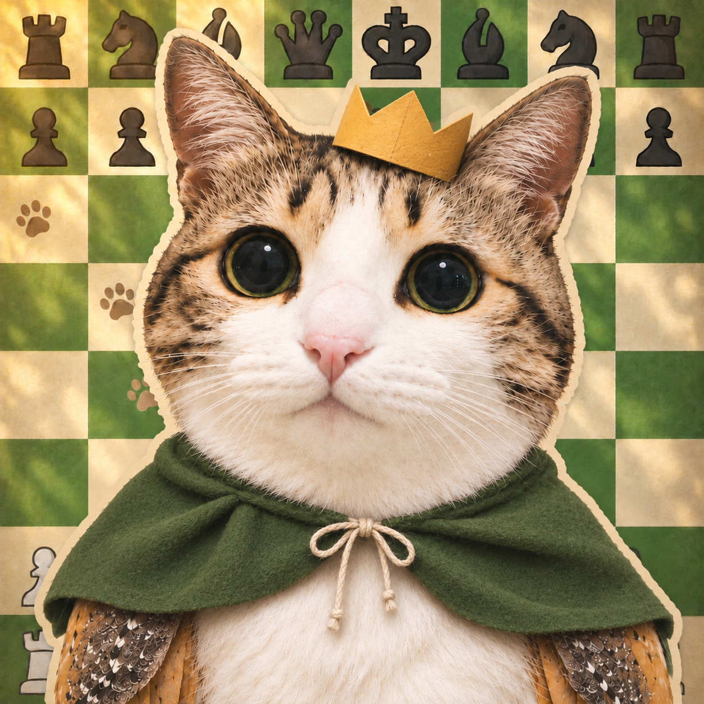
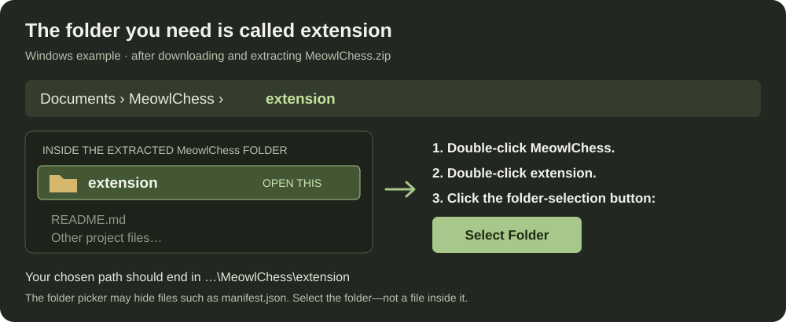

<div align="center">
  
  <h1>MeowlChess</h1>
  <p><strong>Free chess reviews. Local engines. Your own games.</strong></p>
  <p>Review completed games from Chess.com, Lichess, or a PGN file in Brave, Chrome, and Edge.</p>
  <p><sub>Meowl's cat likeness comes from <a href="https://weibo.com/melonpi">Melonpi Cat (瓜皮)</a>. <a href="THIRD_PARTY_NOTICES.md#meowl--melonpi-cat">Artwork credits</a></sub></p>
  <p>
    <a href="https://github.com/ThuyTran735/MeowlChess/releases/latest/download/MeowlChess.zip"><strong>Download ZIP</strong></a> ·
    <a href="#install">Install</a> ·
    <a href="#your-first-review">Get started</a> ·
    <a href="PRIVACY.md">Privacy</a> ·
    <a href="https://github.com/ThuyTran735/MeowlChess/issues">Report an issue</a>
  </p>
</div>

**Version 1.14.0** · [Release notes](https://github.com/ThuyTran735/MeowlChess/releases/tag/v1.14.0) · [Release history](https://github.com/ThuyTran735/MeowlChess/releases)

> Your game, explained. Follow the turning points, explore engine suggestions, and study with an animated Meowl coach—all on your own device.

MeowlChess runs Stockfish or Lozza on your device. No subscription, analysis-service account, or chess-site login is required. Once a game is loaded, its analysis works offline.

| What you can do | How it works |
| --- | --- |
| Review a finished game | See both players' study scores, move ratings, opening, and evaluation graph. |
| Understand a move rating | Click a move's label or rating icon for its saved evidence and continuation. |
| Get a summary on the game page | Opt in to automatic reviews on Chess.com or Lichess. |
| Explore better moves | Follow engine arrows, play legal variations, or search a position more deeply. |
| Practice your mistakes | Try a move again with hints hidden, then check your answer. |
| Ask a local coach | Choose a personality and ask questions about the completed review. |
| Keep a study library | Save completed reviews and bookmark positions locally. |
| Choose your engine and pace | Use Stockfish 18 lite or Lozza 9 with five review speeds. |

MeowlChess is independent of Chess.com and Lichess. Use it **only after a game is finished**, including Daily and correspondence games. Its scores and move labels are its own estimates.

## Install

**Works with desktop Brave, Chrome, and Edge.** You do not need Node.js, a terminal, or a build step to install the release.

### 1. Download the ready-to-use ZIP

[**Download MeowlChess.zip →**](https://github.com/ThuyTran735/MeowlChess/releases/latest/download/MeowlChess.zip)

Or open the [latest release](https://github.com/ThuyTran735/MeowlChess/releases/latest), expand **Assets**, and select **MeowlChess.zip**. Choose that file rather than GitHub's **Source code** downloads.

### 2. Extract it to a permanent folder

On Windows, right-click the ZIP → **Extract All…**. Choose a folder you will keep, such as `Documents\MeowlChess`, and finish extracting. On macOS, double-click the ZIP and move the extracted folder somewhere permanent.

Open the extracted folder. You should find this structure:

```text
MeowlChess/
├── extension/          ← select THIS folder in the next step
│   ├── manifest.json
│   ├── review.html
│   └── ...
├── README.md
└── ...
```

The folder to load is **`extension`**, directly containing **`manifest.json`**. If extraction creates an extra outer folder, open it until you see `extension`. Keep these files in place; the browser loads MeowlChess from this location.

### 3. Load it in your browser

Copy the address for your browser into its address bar and press Enter:

| Browser | Extensions page |
| --- | --- |
| Brave | `brave://extensions` |
| Chrome | `chrome://extensions` |
| Edge | `edge://extensions` |

**A. Turn on Developer mode.** On the extensions page, look for the switch labeled **Developer mode** and turn it on. In Brave and Chrome, look at the top right; in Edge, look in the left sidebar. This makes **Load unpacked** available.

**B. Click Load unpacked.** A folder-selection window opens. You are choosing a **folder**, not opening a ZIP or selecting a file.

**C. Open the folder you extracted in step 2.** For the Windows example above:

1. Open **Documents**.
2. Double-click **MeowlChess**.
3. Double-click the **extension** folder inside it.
4. Click **Select Folder** at the bottom of the window. On macOS, the button may say **Open** or **Select**.

If you extracted somewhere else, use that location instead. The selected path should end in **`MeowlChess\extension`**. If you see another outer `MeowlChess` folder, open it first until you reach `extension`.



**You might not see `manifest.json` in this window. That's normal.** A folder picker can hide files. You only need to select the `extension` folder. To check its contents beforehand, open it in File Explorer or Finder, where `manifest.json` should be visible.

**D. Check that it loaded.** Back on the extensions page, a **MeowlChess — Free Post-Game Analysis** card should appear. Leave its enabled switch on.

**“Manifest file is missing or unreadable”?** You selected the wrong folder or the ZIP is still compressed. Extract the ZIP first, then select the folder containing `manifest.json`, not the ZIP or its parent folder.

**No Load unpacked button?** Make sure you are on the extensions page listed above and that **Developer mode** is on. Browser references: [Chrome's installation guide](https://developer.chrome.com/docs/extensions/get-started/tutorial/hello-world#load-unpacked), [Edge's installation guide](https://learn.microsoft.com/en-us/microsoft-edge/extensions/getting-started/extension-sideloading#locally-installing-and-running-an-extension).

### 4. Pin it and open a game

Open your browser's **Extensions** menu (the puzzle-piece icon), find MeowlChess, and pin it or choose **Show in toolbar**. Click the MeowlChess icon to open the review page. The support prompt and tutorial can both be skipped, with separate **Never show again** checkboxes.

MeowlChess is currently installed as an unpacked extension; it is not in the Chrome Web Store or Edge Add-ons store. These installation steps are for desktop browsers. The review page adapts to narrow screens, but that does not make the extension installable in a mobile browser that lacks extension support.

### Updating without starting over

Open **Updates & backups** from Settings or the review page's footer. This page has the latest-version check, update instructions, and a backup of your saved study data.

**Check now** asks GitHub for the latest public release. You can also enable **Check for updates automatically**: when you open MeowlChess, it checks at most once a day. The setting is off by default and requests permission to contact GitHub's API. A new release appears as a small notice with download and release-note links; dismissing it keeps it out of your way. Checks send no game data, player names, or saved reviews.

Unpacked installations **do not install updates automatically**. To update:

1. Open **Updates & backups** and save a backup before changing the installation.
2. Download and extract the latest **MeowlChess.zip** using the update screen.
3. Copy the new contents into the **same folder you originally installed from**, replacing the old files. For example, replace the contents of `Documents\MeowlChess\extension` with the new `extension` contents; avoid creating an extra `extension\extension` folder.
4. Open your browser's extensions page and click **Reload** on the existing MeowlChess card. If you are unsure which folder is installed, open the card's **Details** and check its source path where available.
5. After your current game or review has finished, refresh open Chess.com or Lichess tabs and reopen the MeowlChess review page. An outdated panel offers a refresh prompt; it does not refresh the website automatically.

Keep the existing installation in the same browser profile and folder. **Do not remove the extension to update it**—removing it can delete its local data. Saved reviews and preferences live in browser storage, separately from the extension files.

### Back up or move your reviews

Use **Updates & backups** to download a local JSON backup containing saved reviews, bookmarks, settings, remembered accounts, and coach unlock progress. Keep this file somewhere you trust: it contains player names and game PGNs, and is not encrypted or uploaded.

To restore, choose the backup file, review its contents summary, and select **Restore**. Existing saved analysis is kept when the same game appears in both places; missing bookmarks are added, while existing bookmark notes are kept. **Restore preferences too** is optional; leave it unchecked if you want to keep your current settings. Remembered accounts are merged. Browser permissions are not included in a backup, so on a new installation, enable on-site reviews and completion alerts again through Settings.

Backup files can be up to **42 MiB** and must fit the library's **100-review / 40 MiB** limits. Invalid files are rejected before anything is restored. If review restoration succeeds but saving preferences fails, the page explains which part finished; you can retry without duplicating reviews.

If a future store version uses a different extension identity, export from the old installation and import into the new one. Confirm your reviews are available **before removing the old installation**. The same process can move your library to another browser or computer; it does not set up automatic syncing.

## Your first review

1. Click **Games** in the top bar. Enter a Chess.com or Lichess username and select **Find games**, choose **Import PGN**, or use **Try a sample game**.
2. Choose a completed game. Open **Settings** in the top bar to choose your engine and review speed, then select **Review game** beside the board.
3. When analysis finishes, the game opens at **move 0** on **Summary** and is saved on this device.

| Where to go | What you will find |
| --- | --- |
| **Summary** | Both players' study scores, estimated game ratings, move counts, and evaluation graph. |
| **Moves** | Move-by-move explanations, key moments, engine lines, and ways to try a better move. |
| **Coach** | A local Meowl coach, selectable personalities, questions, sound, and animation controls. |
| **Practice** | Your saved mistakes and bookmarked positions. |
| **Games → Saved reviews** | Previous analysis, ready to reopen without running the engine again. |
| **Settings** | Analysis, board and playback, notifications, and automatic on-site reviews. |
| **Updates & backups** | Release notifications, guided updating, and local backup or restore. |

To get reviews directly on a website, open **Settings → On-site reviews**, enter your username, enable Chess.com or Lichess, and accept its browser permission prompt. A finished game's panel shows **Finding game → Analyzing → Saving**, followed by its summary. You can move or resize the panel and reopen it from the small MeowlChess button after closing it.

With **Engine arrows** enabled, suggestions follow the reviewed board on every review tab. Use **Board arrows → All engine moves** to see every available candidate, or keep the best move and hover an engine line for alternatives. Arrows stay hidden while you solve a practice retry and when the position has no legal continuation.

**Settings → Board size** changes the board independently of the review controls. Drag to choose a size, then release to apply it; the size readout updates while the slider stays in place. Keyboard changes apply immediately. Select **Auto** to fit the window. Your choice is remembered, and larger boards still shrink to fit smaller screens.

**Settings → Move sounds** enables quiet local sounds when you navigate moves, explore variations, or use Play. Sounds are off by default and stay silent in hidden tabs.

Captured pieces appear beside each player and follow the position you are viewing, including variations. **+N** shows a material advantage using pawn 1, knight/bishop 3, rook 5, and queen 9; it is separate from the engine evaluation. Custom starting positions show only captures made during the game.

Move notation uses small filled piece symbols for White and outlined symbols for Black, including promotions. Pawn moves and castling keep their usual notation. Hover over shortened player names in the board header, score cards, game lists, or saved reviews to see the full names.

The game picker remembers your entry separately for Chess.com and Lichess, including when you open Settings from the on-site panel. Edits are remembered when you leave the field or switch websites, and submitting an entry saves it even if the lookup fails. Clear the field to forget that entry. Successful username lookups also add a shortcut under **Saved accounts**, with up to 10 names per website. Choosing one fills the entry; select **Find games** to load its games. **Forget** removes the shortcut and its matching remembered entry. Saved reviews and the separately configured on-site account stay in place.

The game picker closes after selection. Move through the review with the move list, arrow keys, evaluation graph, key moments, or **Play**. Select a move-rating count on **Summary** to jump to that player’s matching moves, then use the matching-move arrows or **Clear** to return to normal navigation. Hover or focus the evaluation graph to preview a move’s evaluation before selecting it. **Engine lines** stays collapsed until you open it.

On a normal launch, an optional **Support MeowlChess** popup appears before the tutorial. **Star on GitHub** opens the repository in a new tab; you can star it there or choose **Skip** (or press Escape) to continue. Its **Never show again** checkbox is separate from the tutorial preference. Opening a saved review from the on-site panel or going directly to its settings bypasses both prompts.

The six-step tutorial points out the current controls with spotlights and arrows: **Games**, review speed and standout checks, **Summary / Moves / Practice**, Meowl coaches, on-site reviews in **Settings**, and **Updates & backups**. Use **Next**, **Back**, or **Skip**; Escape also skips it. Check **Never show again** to stop automatic tutorials in this browser profile. The footer's **Tutorial** link reopens it, and unchecking that option restores automatic display. The tour follows smaller screens, restores your scroll position, respects reduced motion, and never starts a review, enables site access, or changes your selected game. An existing Never show again choice stays in effect after updating.

## Supported games

| Source | Ways to load a game |
| --- | --- |
| **Chess.com** | Enter a username for recent public games. On-site reviews can find an exact older game from its game page. |
| **Lichess** | Enter a username or completed-game URL; on-site reviews are also available. |
| **Chess.com bots** | Use the finished game's PGN export through the on-site panel, or import it manually. |
| **ChessTempo, ICC / Chessclub.com, Tornelo** | Import a PGN export. Export guidance is included in the import window; automatic account retrieval is not available. |
| **Other sites** | Import a completed standard-chess game from `.pgn` or `.txt`, or paste its PGN. |
| **Saved reviews / Sample** | Reopen local analysis or try the demo without a network request. |

Recent-game lists contain up to **20 completed games**. On a game page, exact-game lookup is separate from that limit: Chess.com searches the configured player's monthly archives, including older months, and Lichess uses the game's public export. The configured username must be one of the players. If a just-finished Chess.com game has not reached the public archive, MeowlChess can read its completed PGN through the site's normal **Share → PGN** dialog.

<details>
<summary><strong>PGN imports and limits</strong></summary>

Choose or drop files, drop PGN text, or paste it into **Import PGN**. A file may contain several games; select one from the resulting list before reviewing it. Importing alone does not start analysis or save every game.

Only legal, completed **standard chess** is supported. Variants and unfinished games are excluded. A PGN needs a final `1-0`, `0-1`, or `1/2-1/2` result. Custom standard-chess starting positions and pawn promotions are supported.

An import can contain **100 games** and **5 MiB** of text in total, with **250 KB** and **1,000 plies** per game. Invalid or unfinished entries are listed as skipped while valid games remain available. An imported result is supplied by the PGN; MeowlChess does not independently confirm it with the original website.

</details>

## Reviews on the game page

Open **Settings → On-site reviews**, enter your username, enable the site, and accept its one-time browser permission request. Chess.com and Lichess are separate settings and are **off by default**. Turn a site off before changing its username.

The panel shows each step clearly:

**Finding game → Analyzing → Saving → Summary**

If loading is waiting or fails, select **Retry loading** to check the current game again without refreshing the page. The button shows when another attempt is available; repeated clicks share the current request and respect the site's retry delay. An unfinished game cannot start a review; an unavailable completed game keeps waiting until its archive record or matching completed export is available. Failed or stopped summary frames also offer Retry loading. Games explicitly marked aborted or canceled by the site show an unavailable message instead of waiting for an archive review. Returning to a completed-game panel can reconnect it without discarding the current summary.

A current saved review goes straight to Summary without another engine run or saving stage. If you enable **Recheck highlights** after saving a review with those checks off, the panel can upgrade that review. New reviews use your saved engine settings, or **Fast / one line** until you save preferences. **Open full review** opens the saved game at move 0 on Summary.

The panel keeps both study scores visible above **Overview** and **Move ratings**. Overview shows the game-rating estimates and performance by phase; Move ratings shows each player's counts. Switch tabs with a click or the arrow keys, and use Home / End to reach the first / last tab. **Open full review** stays within reach while scrolling a small panel.

| Panel control | Action |
| --- | --- |
| Drag the background, summary text, or score cards | Move the panel; buttons, inputs, and scrolling keep their normal behavior. |
| Drag any edge or corner | Resize while keeping the opposite edge in place. |
| Collapse | Keep the header and preserve the expanded size. |
| Close, then select the **MeowlChess** button | Reopen from the bottom-right of the page. A saved summary returns; unfinished analysis starts again. |
| Double-click a resize edge or corner | Restore automatic sizing. |
| Focus the name or bottom-right resize corner | Use arrow keys to move or resize; Shift takes larger steps, and Home resets that control. |

Position and size are remembered separately for each site and kept within the window. Closing the panel, a full page load, leaving the site, or disabling it stops active analysis; partial reviews are not saved. Switching tabs also stops it unless completion alerts are enabled, in which case an already-started review of a confirmed completed game can finish in the background. Use the panel's **Settings** shortcut to turn it off and remove its panel and reopen button. You can also remove site access in the browser's extension settings.

**Browsing between pages:** Your current completed-game review keeps its open, collapsed, or closed state as you browse other pages on the same site, including profiles, home, play, and computer pages. Browsing without a full page load also keeps any active analysis of that completed game running. Opening a different specific game clears the old review immediately and looks up that game's completed record; unavailable or unfinished games stay waiting. A new finished round replaces the prior review, and starting a bot rematch clears it. Full page loads briefly recreate the panel; an already-saved review reopens without another engine run.

<details>
<summary><strong>Chess.com bot games</strong></summary>

Bot games are private and do not appear in the public player archive. After a finished-game notice appears, MeowlChess can open Chess.com's normal PGN export and read the completed game. It closes only the export dialog it opened. A small collapsed header is available on the computer page before the game ends.

If the site's controls or language differ, select **Get finished game**, open **Share → PGN** yourself, or choose **Use a PGN file or paste**. Guest games work too. Full PGN exports preserve promotions and custom starting positions.

Bot reviews are saved as PGN imports. Their result comes from the export and cannot be independently confirmed through the public archive. An unfinished bot game never falls back to an older human game. MeowlChess does not read live boards or private bot-game APIs.

</details>

<details>
<summary><strong>Retrieval, timing, and page access</strong></summary>

On Chess.com's multiplayer play screen, MeowlChess watches for a finished-game notice and a new archive entry. On other supported pages, it can show the latest completed game. When the exact finished game's archive entry is delayed, it can open the site's normal **Share → PGN** dialog and read that game's completed export locally. The export must link to the current game and include the configured player, legal standard-chess moves, and a final result. It closes only the export dialog it opened. The panel contains no board, engine lines, or move suggestions.

When Chess.com shows a finished-game notice, MeowlChess refreshes the lookup immediately. If the completed PGN is unavailable, it retries the archive every **15 seconds for up to two minutes**. Normal checks use a **60-second interval on Chess.com** and **30 seconds on Lichess**; connection errors keep the normal retry delay. Cached games and temporary review handles use browser session storage, capped at **700 KB** and cleared when the browser restarts. This lets an open summary survive an extension background restart.

The page helper reads the URL, visible game-end notices, and completed-game PGN exports from the site's normal Share dialog. It does not read live board positions, make moves, or use private game APIs. Public API requests omit login cookies and private Lichess player keys. Disabling a site removes its panel and prevents future helper injection.

</details>

## Engines and review settings

| Engine | Best suited to | Lines |
| --- | --- | --- |
| **Stockfish 18 lite** | Stronger analysis and comparison of alternatives | Up to 3 |
| **Lozza 9** | A smaller JavaScript engine without WebAssembly startup | Best move only |

Both engines are bundled. Switching engines downloads nothing. Lozza is a weaker alternative, not a faster Stockfish; startup and search times depend on your computer. More lines share the available search time and can reduce depth.

**Recheck key mistakes** is on by default. It makes a quick first pass, then spends more time on the most important estimated losses or mate changes. Short searches and selective rechecks can still miss tactics.

**Check standout moves** beside the review controls (also **Settings → Analysis → Recheck highlights**) controls the separate, deeper checks for likely Brilliant and Great moves. It is on by default. Turn it off to save time in both the full review and on-site panel; normal move ratings still work, but shorter searches can miss standout moves. This choice is remembered and included in backups. Already-saved richer reviews reopen immediately; enabling highlights can upgrade an on-site review previously saved with those checks off.

<details>
<summary><strong>Speeds and selective rechecks</strong></summary>

| Speed | Key-mistake rechecks off | First pass, key-mistake rechecks on |
| --- | --- | --- |
| Fast | 0.05 seconds | 0.05 seconds |
| Quick | 0.15 seconds | 0.15 seconds |
| Standard | 0.5 seconds | 0.15 seconds |
| Deep | 1.5 seconds | 0.15 seconds |
| Thorough | 3 seconds | 0.15 seconds |

With rechecks enabled, the first pass is capped at 0.15 seconds per nonterminal position. Rechecks search both sides of each selected move before assigning its final label, using the chosen time with a minimum of 0.5 seconds and maximum of 3 seconds per position. At most eight moves are revisited, fewer in short games; shared positions are searched once. Progress separates the initial scan, optional mistake rechecks, and deeper checks of likely standout moves. Each stage can be canceled; standout checks can run even with mistake rechecks turned off. The review page and on-site panel show an approximate time remaining based on actual progress. First-pass estimates exclude later mistake and standout checks, whose length is known only after candidate moves are selected; engine startup and saving have no countdown. After completion, **Reviewed in** shows the actual time spent on local analysis, including engine startup, mistake rechecks, and standout checks, but excluding game retrieval and saving. The duration is retained with saved reviews; older reviews without a recorded duration omit it.

Fast automatically selects one line. For 100 nonterminal positions, its first pass uses about five seconds of engine time, plus startup and processing. Mistake rechecks and standout checks add time. Turning mistake rechecks off gives every nonterminal position the full chosen time in the first pass. Turn **Recheck highlights** off as well to skip deeper standout checks afterward.

</details>

## Completion alerts and sharing

In **Settings**, enable **Notify me when a review finishes** to request optional browser notification permission. It is off by default. A newly completed, successfully saved review can show a quiet desktop alert when you are away from its tab. Select the alert to open that exact saved game at move 0 on Summary. Reopening saved analysis, canceled reviews, and failed saves do not send an alert. Browser or operating-system notification settings may suppress alerts.

With alerts enabled, an on-site review that has already started can finish after you switch tabs. MeowlChess does not start new game lookups or page exports while that page is hidden. Closing the page or panel, changing the game, or turning the setting off while it is hidden stops that work.

Use **Share summary** from the main Summary tab or the panel's share icon to preview a **1200 × 1200 PNG** with both study scores, estimated game ratings, phase performance, and move counts. **Copy image** puts it on your clipboard; **Save image** downloads it with a `MeowlChess-` filename. If the browser blocks clipboard access in the panel, use Save image. **Hide player names** replaces usernames with White and Black in the preview and exported image, and uses the filename `MeowlChess-summary.png`. The choice is remembered for both the main page and panel; the underlying saved game keeps its original names. Images are created locally from the existing review; nothing is uploaded and no new analysis runs.

## Study the game

- **Try again:** replay the position before a reviewed move with engine lines, arrows, ratings, and evaluation hidden. The engine checks your attempt; a sound alternative can pass even if it differs from its first choice. Retry, reveal a continuation, or move to the next mistake. Inconclusive searches are marked uncertain.
- **Explore a variation:** select an engine line, click a piece and destination, or drag a piece. Only legal moves are accepted. Promotions offer queen, rook, bishop, or knight for either color, including captures; Cancel or Escape leaves the position unchanged. **Return to game** restores the original review position without changing the game's moves.
- **Show why:** follow a legal continuation with concrete evidence such as checkmate, a verified fork, or lasting material loss. If no simple consequence can be verified, MeowlChess shows the line without inventing an explanation. These are limited engine observations, not a human coach's assessment.
- **Search further:** **Quick look** spends 0.15 seconds on the displayed position; **Analyze deeper** spends at least 1.5 seconds. Both update that position's evaluation and lines. **Review again** recalculates the full game's labels and scores.

With Engine arrows enabled, the best suggestion follows the displayed board on every review tab, including Summary and Coach. Hover over or keyboard-focus another line to preview it, or enable **All engine moves**: green is first, blue second, orange third. Knight arrows turn at a right angle. Arrows always describe the displayed position and side to move; terminal positions have no continuation.

**Face my side** uses your entered or remembered username to put your pieces at the bottom. You can disable it or flip the board manually. Retry mode faces the player whose move is being retried. Display choices and playback speed are saved locally, and motion respects reduced-motion preferences.

## Ask your coach

Moves mentioned in coach tips, chat replies, suggested lines, and move buttons use chess-piece symbols. Filled symbols identify White’s pieces; outlined symbols identify Black’s. Coach explanations also show a pawn for pawn moves and a king for castling. Captures, promotion pieces, and check or mate marks remain visible; hovering a move shows its original notation.

**Explanation length** starts at **Brief** for concise tips and answers. Choose **Detailed** for fuller reasoning and continuations. Changing it updates the current automatic tip and future replies while keeping your conversation. Your choice is remembered and included in backups. Open **Change coach** when you want a different personality.

In **Moves**, click the selected move's rating heading or an icon in the move list to see **why that move earned its label**. The explanation uses the saved search, estimated chance loss, and verified tactical evidence where available. Older reviews with incomplete evidence say so rather than inventing a reason. This opens instantly without another engine run; close it or press Escape to return to the game.

**Explain moves automatically** is on by default. As you step through a completed review in Moves or Coach, one short comment follows the selected move without filling your chat. It follows **Focus on**, pauses during practice or variations, and skips past positions when you scrub quickly. Turn it off under **Coach settings**; animation and sound preferences remain separate.

After reviewing a game, open **Coach** beside Summary and Moves. Start with curious **Meowl**, precise **Professor Meowl**, spirited **Captain Paws**, patient **Mellow Meowl**, or tactics-focused **Scout Meowl**. Every coach has the same round, dark Meowl eyes. Regular Meowl is crown-free; Professor wears glasses; Captain has bold brows; Mellow wears a soft cardigan; Scout has cheek freckles and field gear. Their outfits, expressions, and gestures give each character a distinct personality. The same facial features appear in the portraits and stay with the head during talking, blinking, and glances. Your selected coach appears beside the board on larger screens and below it on smaller screens, with small portraits in chat replies. Choose a portrait in the coach picker. Every coach uses the same saved analysis, with their own approach to explaining it: Meowl explores ideas with playful curiosity; Professor asks for evidence; Captain sets small challenges; Mellow offers one reassuring next step; Scout investigates tactical clues. Their tips respond to checks, captures, castling, promotions, and the available engine line. Chat discussions about openings, material, and game phases also follow the selected personality. Move ratings, scores, and legal continuations remain the same across coaches.

**Evil Meowl** unlocks after **10 different completed games** have been reviewed and saved. Existing valid saved reviews count, re-reviewing the same game adds no extra progress, and the built-in Sample does not count. Progress stays on this device when you delete saved reviews; clearing the extension's data resets it. The coach picker shows your progress. Evil Meowl has charcoal fur, a silvery muzzle, curved devil horns, and a sly little smirk. His dark-red outfit and wing-held pitchfork complete the look. He turns study into playful little schemes: test the opponent's reply before the evil laugh. Starring the GitHub repository is optional and has no effect on unlocking coaches.

Choose **White**, **Black**, or **Both** to set the side you want to discuss. Ask a question or start with a suggested prompt:

- “What was my biggest mistake?”
- “Why was this move a blunder?”
- “What was better on 12...?”
- “What opening was this?”
- “What should I practice?”

Ask **“Show Brilliant and Great moves”**, **“How many brilliants did White play?”**, or **“Show Black's mistakes”** to search the whole reviewed game. The coach recognizes every move rating, shows the actual matching labels and counts, and links to those moves. Asking why a specific move received its rating still explains that exact move. It reports the saved review's labels without inventing new awards.

The coach follows the position displayed on the board. **Ask about this move** beside the Meowl opens the conversation for that position. **Explain this position** gives a brief account of the side to move, the saved evaluation, and a legal continuation. **Next key moment** finds the next saved highlight or mistake for your selected side. Move links in its answers take you to that moment while keeping the conversation open. On a game website, **Ask coach** opens that saved game's Coach tab in the full review.

Coaching is free and entirely local. It uses built-in question matching, legal engine continuations, and the completed review; it is not an open-ended AI model. Unrecognized questions get suggested alternatives, and explanations stay within the available evidence. Re-reviewing more deeply can change its assessment. Coach answers are unavailable during retry practice and while exploring an unsaved variation.

Each coach has a repertoire of greetings, thinking gestures, celebrations, encouragement, and quiet talking motions, with three takes for each reaction. Meowl follows feathers and takes little playful steps; Professor checks his book and glasses; Captain salutes and waves a pennant; Mellow cradles a warm cup and tidies his scarf; Scout follows clues with a magnifying glass; Evil Meowl plots with conspiratorial glances and small villainous flourishes. Wings, feet, ears, and heads move separately while the characters keep their proportions. Their eyes and heads follow the action, including reading a page, lifting a cup, or watching a feather. Wings grip the book and cup, and Professor's open pages face toward him. **Brilliant**, **Great**, and **Best** moves have distinct reactions, good moves get approval, and mistakes get encouragement. Reactions show the move's saved rating icon. **Focus on** controls whose moves get these reactions. Tap or keyboard-activate your coach to see his greeting.

Between comments, each Meowl has **40 quiet idle routines**: listening, investigating a feather, adjusting glasses, checking a book, standing at ease, warming a cup, tidying an outfit, or scanning for clues. The newer scenes add toe inspections, careful shuffles, quiet marches, cup balancing, and pitchfork antics. Each coach uses a shuffled rotation that visits every routine before repeating, with varied pauses between actions. Idles continue while you read Summary and remain silent. Talking uses quieter gestures, moving eyes, and mouth movements; longer replies keep the coach talking for a short, complete phrase. New comments briefly settle an unfinished gesture before the next reaction begins. **Coach animations** can be turned off, and reduced-motion settings keep reactions still. Move commentary stops on Summary; animations pause during practice attempts, variations, loading, and hidden tabs.

The coach has a dedicated card to the left of the board on wide screens and below the review content on smaller screens, keeping the game results easy to reach. Change coaches from its selector, toggle move tips or sound, open coach settings, or ask about the current move without hunting through tabs. The chat button also stays available on Summary.

In **Coach settings → Animation preview**, choose a signature routine, greeting, talking or thinking gesture, move reaction, or **While waiting** idle. Select **Play** to see it; replaying cycles through three takes for reactions or draws another action from the idle rotation. The menu shows action names and the idle count for your selected coach. Previews are silent and do not change the game, its ratings, or the conversation.

**Coach settings** keeps commentary, animation, sound, and **Meow volume** controls together. The volume remembers your chosen level. **Meow sounds** stays off by default; enable it to hear reactions or use **Preview**. Coaches use 35 real cat recordings: 23 meows, 11 chirps and trills, and one purring chirrup, played at their original pitch and speed. When animations are enabled, mouth movement follows the recording and closes during quiet gaps. The clips rotate between comments, celebrations, curious reactions, and greetings without immediate repeats. Recordings are bundled for offline playback; idle gestures are silent. Each coach also blinks and makes small glances between idle gestures. See the [recording credits](THIRD_PARTY_NOTICES.md#recorded-coach-meows).

Coach, side, automatic-commentary, animation, sound, and volume preferences are remembered on this device. Chats keep the most recent 12 question-and-answer pairs in the open tab, and clear when you switch games, re-review, reload, or select **Clear chat**. Messages are not saved to your library or sent to a service.

## Saved reviews and practice

Successful full reviews save automatically on your device. Recent games and imported PGNs with matching saved analysis show a **Reviewed** badge; select the game to open its saved review directly at move 0 on Summary, without another engine run. **Reviewed · older** identifies saved analysis from an earlier analysis version. The game picker refreshes these badges when opened or brought back into focus. If a saved copy has been removed or cannot be opened, the original game remains available to review.

Search saved games by player or recognized opening, bookmark a position, or open **Practice** to revisit mistakes and bookmarks. Saved games open at move 0 on Summary; bookmarks and practice items open at their position. A saved mistake starts a fresh attempt with hints hidden.

Re-reviewing a game replaces its analysis and keeps its bookmarks. Older analysis is marked so you can choose to refresh it. Temporary variations, practice attempts, and extra position searches are not added to the saved full review.

<details>
<summary><strong>Storage, limits, and deletion</strong></summary>

The local IndexedDB library stores PGNs, player/source information, evaluations and lines, move ratings, scores, opening information, and engine settings. It persists after the tab closes and holds up to **100 reviews**, **40 MiB** in total, and **4 MiB** per review.

MeowlChess does not automatically remove old or bookmarked games to make room. If a limit or browser storage error prevents saving, the current review stays open and an error explains the problem.

Use a saved game's **×** button to delete its stored PGN, analysis, and bookmarks. An already open copy remains in memory; reviewing it again saves it again. Uninstalling removes local extension data. Libraries are separate for each browser profile and do not sync between browsers or devices.

</details>

## Understanding the scores

Evaluations, move labels, and study scores are **MeowlChess estimates**. They do not reproduce Chess.com's proprietary accuracy or classification algorithms. A different engine or longer search can change the result. The graph and displayed evaluations use White's perspective; move counts are separated by player.

The full review and on-site summary also show **Game rating** for each player and **Opening / Middlegame / Endgame** icons. The rating describes this game only, with an approximate value rounded to 50 points and a visible rough range. It is labeled **MeowlChess estimate** to distinguish it from Chess.com's own rating. Phase icons summarize each player's moves in that part of the game. Saved reviews gain the current estimates without another engine run.

<details>
<summary><strong>Game-rating estimates and phase icons</strong></summary>

Game rating is an **independent, experimental MeowlChess study estimate**, not an account rating, calibrated Elo, or Chess.com's formula. The concept is similar to [single-game performance in Chess.com's Game Review](https://support.chess.com/en/articles/10773754-how-is-game-rating-calculated-in-game-review), but the numbers need not match. Engine choice and search time can affect the result.

Each player needs a **rating recorded in the PGN** and at least **8 eligible decisions**. Book moves, forced moves, and inconsequential moves in already decisive positions are excluded. Giving away a winning advantage or losing a forced mate still counts. Missing ratings or too few decisions display **—**. Custom starting positions are supported when enough decisions and a recorded rating are present.

The estimate compares average winning-chance loss with a reference based on the player's recorded rating. Poor play can produce an estimate far below that rating; it is no longer held near the account rating by a fixed downward adjustment limit. A few reference decisions stabilize small samples, while upward adjustments remain cautious so a short, clean game does not imply master strength. The reference curve and safeguards are project choices, not a fitted prediction of human Elo. The recorded rating retains its source's scale: a Lichess rating is not converted into a Chess.com rating.

The visible **range is a rough sensitivity guide, not a statistical confidence interval**. It reflects the number of reviewable decisions, variation in move losses, and analysis depth; shorter games and shallow searches widen it. Hover a value for its recorded rating, average winning-chance loss, decision count, and coverage. The full review, on-site panel, and shared summary image use the same estimate and range.

Phases use the position **before** each move:

- **Opening:** the first 20 plies (10 moves per side) from the standard starting position, unless the endgame threshold is reached sooner. Custom starting positions are not assigned an opening phase.
- **Endgame:** total remaining non-pawn material reaches 6 phase units or fewer, counting each knight/bishop as 1, rook as 2, and queen as 4 across both players. The starting position has 24 units. Once reached, the endgame continues even after promotion.
- **Middlegame:** the moves between those phases. Games ending early may have no middlegame or endgame; missing phases show **—**.

Phase grades use mean non-Book expected-score loss with the same Excellent / Good / Inaccuracy / Mistake / Blunder thresholds as individual moves. **Best** requires all scored moves to be engine-preferred and less than 1% mean loss. **Brilliant** or **Great** requires an actual move of that classification, less than 1% mean loss, and no move with 4% or greater loss or an error label. A phase containing only Book moves shows the Book icon. Hover an icon for its player, grade, and move count.

</details>

<details>
<summary><strong>Move labels and score calculation</strong></summary>

| Label | Meaning |
| --- | --- |
| Brilliant | A sound piece or exchange sacrifice supported by deeper analysis and a legal material-gaining capture for the opponent. |
| Great | A critical choice, or a best or nearly best continuation that converts an opponent's error into a verified tactical gain. |
| Best | The engine's preferred move. |
| Excellent | Almost no estimated loss. |
| Good | Little estimated loss. |
| Book | A recorded opening move without a detected error at the chosen search time. |
| Inaccuracy | A small reduction in estimated chances. |
| Mistake | A significant reduction in estimated chances. |
| Blunder | A large reduction in estimated chances. |

With **Recheck highlights** enabled, every review speed checks a bounded set of likely standout moves more deeply, including Fast mode. The highlight pass uses at least two seconds per checked position to reduce unstable labels from the quick scan, with at most eight candidate moves. Turning it off skips this extra pass; Brilliant and Great can still appear when the normal search supplies enough evidence. Brilliant and Great require depth 12 or greater in the relevant positions and stable evaluations. Brilliant considers legal captures and recaptures, including exchange sacrifices and offers that the engine declines. A recapture can qualify when the recapturing piece itself is offered at a net material loss; ordinary equal trades do not qualify.

Great requires coherent alternative engine lines showing an only-good move, a critical choice, or a near-best tactical continuation after an opponent's error. Tactical continuations must demonstrate a lasting material gain in a legal engine line. Stockfish checks at least two lines for likely highlights even if the review displays one; shallow positions before the opponent's error are also checked when needed. Lozza cannot confirm these comparative claims because it supplies one line.

Already won positions normally need evidence that simpler alternatives lose the overwhelming advantage. A verified mating combination can also earn Brilliant when the opponent accepts a material sacrifice and the complete legal engine line ends in checkmate. These are independent MeowlChess rules and can differ from Chess.com's labels. Miss artwork is included, but there is no separate missed-win classification.

New study scores use the [public Lichess accuracy method](https://lichess.org/page/accuracy): move scores derived from lost chances, then an average of a volatility-weighted mean and a harmonic mean. This gives critical mistakes more influence than a simple average of many easy moves. Engine-preferred moves score 100; Book moves are excluded, and a player with no scored moves shows **—**. These are local estimates, not Chess.com's CAPS2 scores. Existing saved scores keep their original calculation until the game is reviewed again.

</details>

<details>
<summary><strong>Opening recognition</strong></summary>

The local reference contains **3,865 lines** from the pinned [Lichess opening-name dataset](https://github.com/lichess-org/chess-openings/tree/712a58be746c143f4ab935b68acc50f4bac813eb), released under CC0. It matches the actual move sequence from the standard starting position, reporting the deepest named opening and first departure from a recorded line. Custom starting positions are not matched. Unrecognized continuations or different move orders are not necessarily mistakes.

The reference includes traps and unsound lines. **Book** applies only when a recorded move is otherwise rated Best, Excellent, or Good. Tactical errors, Brilliant/Great classifications, and checkmate retain their labels. An opening name does not establish that every move is sound.

</details>

## Privacy and fair play

Analysis stays on your device. MeowlChess has no analytics, advertising, remote analysis server, or developer-operated service. Saved PGNs, reviews, and bookmarks are not uploaded by MeowlChess.

Public game retrieval contacts Chess.com or Lichess. Optional update checks contact GitHub for release metadata only. Optional page access is requested only when you enable on-site reviews. Preferences use `chrome.storage.local`; the study library uses local IndexedDB. Browser host permissions apply to an origin even when a manifest entry contains a path. See the [privacy notice](PRIVACY.md) for permissions, retention, and deletion details.

Use only completed games and follow [Chess.com's Fair Play rules](https://www.chess.com/legal/fair-play) and [Lichess fair play](https://lichess.org/page/fair-play). API references: [Chess.com Published-Data API](https://www.chess.com/news/view/published-data-api) and [Lichess API documentation](https://lichess.org/api) (Games → Export games of a user / Export one game).

## Development

```sh
npm ci --ignore-scripts
npm run build
npm test
npm run package
```

The build refreshes pinned chess.js and Stockfish assets. Lozza, artwork, and generated opening data are checked in. Regenerate openings from the bundled pinned TSV sources with `node scripts/build-openings.mjs`.

Packaging writes **`dist/MeowlChess.zip`** with the ready-to-load extension, project source, tests, notices, opening sources, and Stockfish's corresponding source and evaluation network. Dependencies, generated test results, and Git data are excluded.

`npm run package:store` separately creates **`dist/MeowlChess-store.zip`**, with `manifest.json` at the archive root, runtime assets, notices, and bundled engine source materials. This command prepares a store upload; it does not publish one or change an existing unpacked installation. See the [store submission guide](docs/MeowlChess-store-submission.md) for listing text, package details, and the remaining submission work.

<details>
<summary><strong>Browser checks</strong></summary>

Browser checks use Playwright and disposable profiles. Set `CHROMIUM_PATH` to a compatible Brave/Chromium executable, or install Chromium with `npx playwright-core install chromium`.

```sh
npm run test:browser
npm run test:extension
npm run test:features
npm run test:ui
npm run test:performance
npm run test:reviewed
npm run test:imports
npm run test:tutorial
npm run test:notation
npm run test:usernames
npm run test:site-review
npm run test:site-bot
npm run test:site-panel
npm run test:site-panel-extension
npm run test:board-qol
npm run test:accounts
npm run test:sounds
npm run test:sharing
```

The site checks use controlled Chess.com/Lichess pages, local API fixtures, and real engines. They cover automatic review, bot exports and fallback, panel movement and resizing, scrolling, controls, and icons. Other checks cover study/library flows, multi-game imports and promotions, and tutorial behavior. These fixtures do not establish compatibility with every live site layout. Chrome compatibility has not been checked directly. Tests do not change your usual browser installation.

`BROWSER_OFFLINE_ASSETS=1` serves local assets in page tests. `LIVE_API_USERNAME` enables an optional real Chess.com lookup. `LIVE_LICHESS_USERNAME` checks a live Lichess archive and game URL; use `HEADED_EXT_TEST=1` for a normal minimized browser because Lichess rejects headless browser user-agents.

</details>

## Help and contributions

Found a problem or have an idea? [Open an issue](https://github.com/ThuyTran735/MeowlChess/issues) with your browser, extension version, and the steps to reproduce it. For review problems, include the engine/speed settings and a completed-game link or PGN when available.

[Browse the source](https://github.com/ThuyTran735/MeowlChess) · [View releases](https://github.com/ThuyTran735/MeowlChess/releases) · [Privacy notice](PRIVACY.md) · [Third-party notices](THIRD_PARTY_NOTICES.md)

## License and artwork

MeowlChess code is [GPL-3.0-or-later](LICENSE). Stockfish is GPL-licensed, chess.js is BSD-2-Clause, Lozza has its own permissive license, and the Lichess opening dataset is CC0. Keep the included notices and engine source materials with redistributions.

The Chess.com Neo pieces and move-icon outlines are third-party artwork, excluded from MeowlChess's code license. Their inclusion does not assert a license grant or affiliation with Chess.com. The project icon features Meowl, whose cat likeness comes from **Melonpi Cat (瓜皮 / Guapi)**. Cat/photo credit: [瓜皮的id酱 (@melonpi on Weibo)](https://weibo.com/melonpi). See [THIRD_PARTY_NOTICES.md](THIRD_PARTY_NOTICES.md) for sources and license details.
